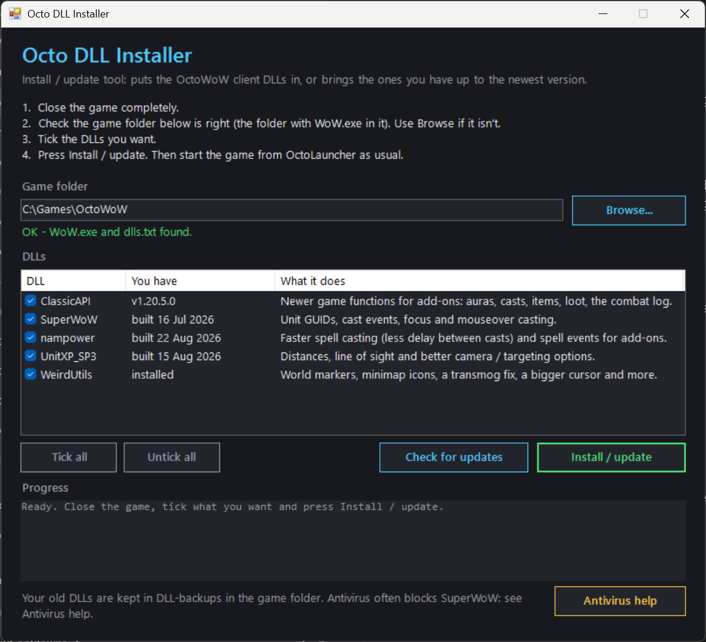
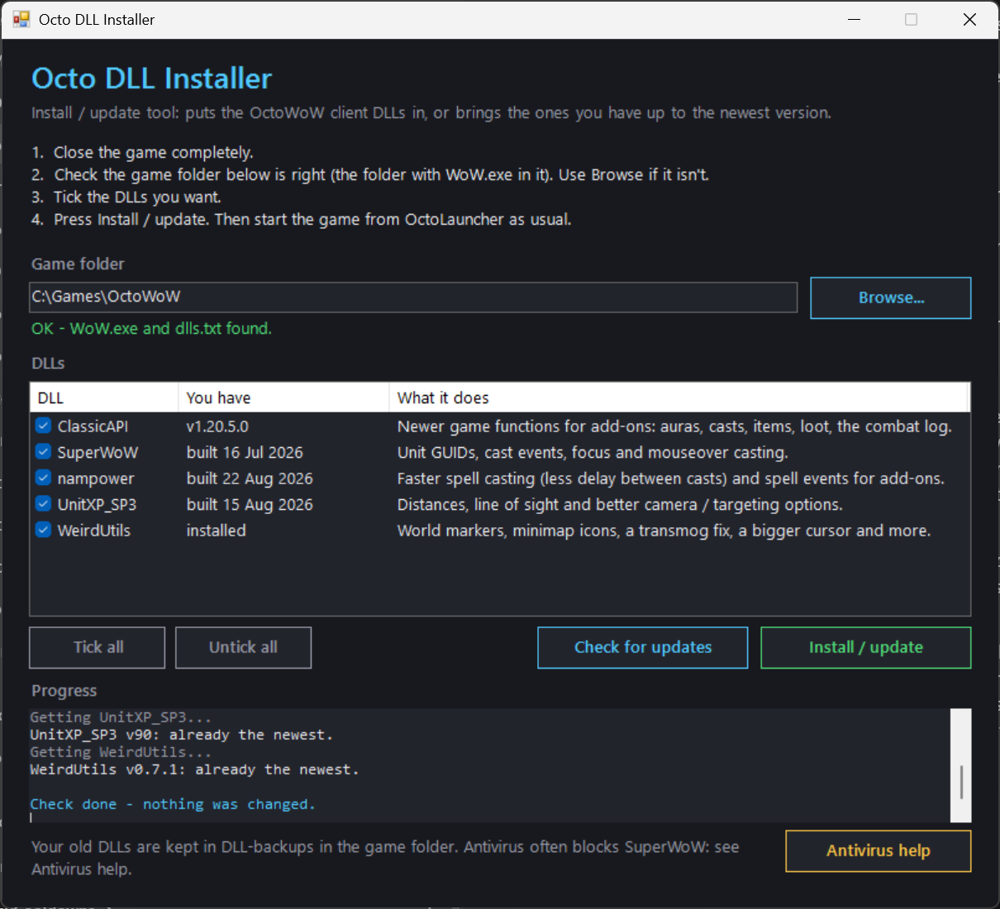

# Octo DLL Installer

An **install / update tool** for the **OctoWoW** client DLLs. It puts in the DLLs you don't have yet, and brings the ones you have up to the newest version, straight from their authors' release pages.
Tick what you want, press **Install / update**. No add-ons needed. Run it again any time to update.

## How to use

1. **Download** [OctoDLLInstaller-v1.0.0.zip](https://github.com/bdot89/OctoDLLInstaller/releases/latest) from the latest release and unzip it anywhere.
2. **Close the game** completely.
3. Double-click **`Install or update DLLs.bat`**. The window opens.
4. Check the **game folder** is right (the folder with `WoW.exe` in it). If it isn't, press **Browse** and pick it.
5. **Tick** the DLLs you want (all are ticked to start with).
6. Press **Install / update**. When it says *Done*, start the game from **OctoLauncher** as usual.

**To update later**, just run it again: DLLs you don't have are installed, older ones are updated, and the newest ones are left alone.
**Check for updates** only tells you what would change. It changes nothing.

## The DLLs

| DLL | What it does |
| --- | --- |
| [ClassicAPI](https://github.com/brues-code/ClassicAPI) | Newer game functions for add-ons: auras, casts, items, loot, the combat log |
| [SuperWoW](https://github.com/balakethelock/SuperWoW) | Unit GUIDs, cast events, focus and mouseover casting |
| [nampower](https://github.com/brues-code/nampower) | Faster spell casting (less delay between casts) and spell events for add-ons |
| [UnitXP_SP3](https://github.com/brues-code/UnitXP_SP3) | Distances, line of sight, better camera and targeting options |
| [WeirdUtils](https://codeberg.org/MarcelineVQ/WeirdUtils) | World markers, minimap icons, a transmog fix, a bigger cursor and more |

## Safe by design

- A DLL is only replaced when the download is different, and **never** when the one you have is newer.
- Your old DLLs are kept in **`DLL-backups`** inside the game folder.
- New DLLs are added to **`dlls.txt`** (the list the launcher loads). The first time, your old list is saved as `dlls.txt.pfui-backup`.
- Every download is checked to be a real Windows DLL before it's used.

**No `dlls.txt` yet?** Start the game once from OctoLauncher with the **vanillaHelpers** mod ticked, close it, then run the installer again.

**Undo:** copy the old DLL back from `DLL-backups`, or rename `dlls.txt.pfui-backup` back to `dlls.txt`.

## SuperWoW and Windows Defender

Windows Defender and other antivirus programs often flag **SuperWoW**. It changes how the game runs, which looks like what cheats and viruses do.
It's a well-known OctoWoW / Turtle WoW mod, but only allow it if you trust it. The tool's **Antivirus help** button shows these steps too.

**The easy way: allow what was blocked**

1. Open **Windows Security** (Start menu > type *Windows Security*).
2. **Virus & threat protection** > **Protection history**.
3. Click the newest **SuperWoW** item > **Actions** > **Allow on device**.
4. Press **Install / update** in the tool again.

**If it keeps getting blocked: exclude the game folder**

1. **Windows Security** > **Virus & threat protection**.
2. Under *Virus & threat protection settings* click **Manage settings**.
3. Scroll to **Exclusions** > **Add or remove exclusions**.
4. **Add an exclusion** > **Folder** > pick your game folder (the one with `WoW.exe`).
5. Press **Install / update** again. The tool downloads into the game folder, so the exclusion covers the download too.

**Another antivirus** (Avast, Norton, McAfee ...): look in its *Quarantine* or *Exceptions*, restore `SuperWoWhook.dll`, or add the game folder as an exception.

## Nothing opens?

Right-click **`Install or update DLLs.bat`** > **Run as administrator**, or right-click `installer\OctoDLLInstaller.ps1` > **Run with PowerShell**.

---

The DLLs belong to their authors; this tool only downloads them from their official release pages.
