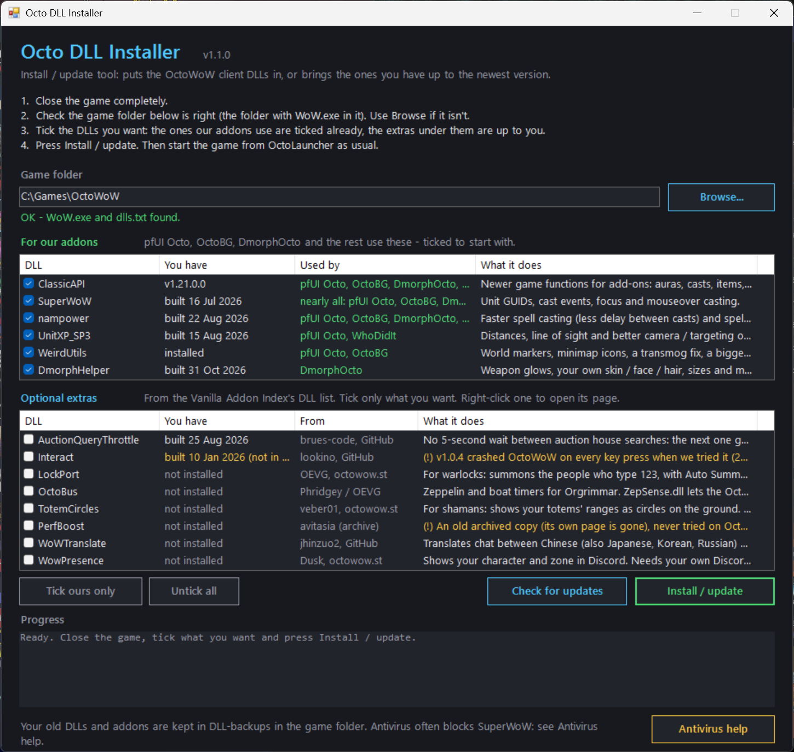
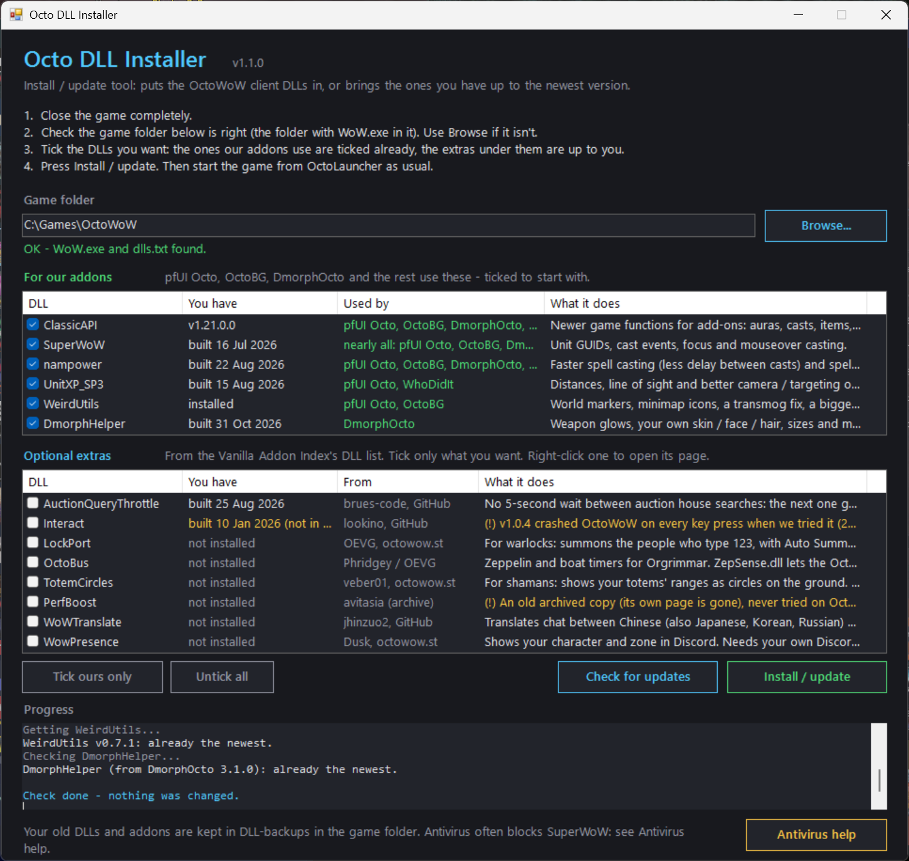

# Octo DLL Installer

An **install / update tool** for the **OctoWoW** client DLLs. It puts in the DLLs you don't have yet, and brings the ones you have up to the tested version, straight from their authors' release pages. Every DLL is **pinned**: one release, checked by its SHA-256 (see [Pinned versions](#pinned-versions)).
Tick what you want, press **Install / update**. No add-ons needed. Run it again any time to update.
**On Linux?** See [Linux](#linux-wine-proton-lutris): one terminal command does the same.



## Fresh install: the whole setup, step by step

New OctoWoW install, or the DLLs or addons don't work? Do these in order.

1. **Install the game with OctoLauncher** and let it finish downloading.
2. In OctoLauncher's **Settings / Mods**, make sure **vanillaFixes** is **on**. VanillaFixes is what loads the DLLs: with it off, none of them load. Leave **vanillaHelpers**, **nampower**, **unitXp** and **dxvk** on too.
3. **Close the game and the launcher's game window** completely.
4. Run this tool (see *How to use* below) and press **Install / update**. On a fresh install it also:
   - makes `dlls.txt` if there isn't one yet,
   - puts in **VanillaFixes** (`VanillaFixes.exe` + `VfPatcher.dll`, nothing else) if it is missing,
   - puts in **SuperWoW**, which the launcher doesn't install.
5. If the tool says a file is **missing** afterwards, your antivirus removed it: see *SuperWoW and Windows Defender* below, or use OctoLauncher's **Restore blocked files**, then press Install / update again.
6. **Add pfUI Octo in the launcher:** OctoLauncher > **Addons** > **Add custom git addon** > paste
   **`https://github.com/bdot89/pfUI`** > **Install**. The launcher then keeps it up to date. (Use that exact link: it is the repository the launcher can read. The *pfUI-Octo* repository is where the releases are.)
7. Start the game **from OctoLauncher**, or with the **Play OctoWoW** shortcut the tool puts on your desktop. The first time after new DLLs went in, VanillaFixes may ask you to confirm the DLL list: say yes.

## Starting the game (old installs too)

The DLLs only load when the game starts **through VanillaFixes**. Starting `WoW.exe` itself loads none of them.

- **OctoLauncher:** turn its **vanillaFixes** mod on (Settings / Mods) and press Play as usual.
- **Without the launcher**, or an old install: run this tool once. It puts VanillaFixes in if it's missing and makes a **Play OctoWoW** shortcut on your desktop. Always start the game with that shortcut, or by double-clicking `VanillaFixes.exe` in the game folder.
- You don't need to drag `WoW.exe` onto VanillaFixes: it finds `WoW.exe` in its own folder by itself. Dragging is only needed if your game's exe has a different name.

## How to use

1. **Download** the zip from the [latest release](https://github.com/bdot89/OctoDLLInstaller/releases/latest) and unzip it anywhere.
2. **Close the game** completely.
3. Double-click **`Install or update DLLs.bat`**. The window opens.
4. Check the **game folder** is right (the folder with `WoW.exe` in it). If it isn't, press **Browse** and pick it.
5. **Tick** the DLLs you want. The top list, **For our addons**, is ticked to start with; the **Optional extras** under it are up to you.
6. Press **Install / update**. When it says *Done*, start the game from **OctoLauncher** as usual, or with the **Play OctoWoW** desktop shortcut (never `WoW.exe` itself).

**To update later**, get the newest Octo DLL Installer and run it again: DLLs you don't have are installed, older ones are brought up to the pinned version, and ones already on it (or newer) are left alone.
**Check for updates** only tells you what would change. It changes nothing. **Right-click** a DLL to open its page.



## For our addons (ticked to start with)

| DLL | What it does | Used by |
| --- | --- | --- |
| [ClassicAPI](https://github.com/brues-code/ClassicAPI) | Newer game functions for add-ons: auras, casts, items, loot, the combat log | pfUI Octo, OctoBG, DmorphOcto, WhoDidIt, OctoArenaFrames, KillShot, UpsiAuras |
| [SuperWoW](https://github.com/balakethelock/SuperWoW) | Unit GUIDs, cast events, focus and mouseover casting | nearly all of them |
| [nampower](https://github.com/brues-code/nampower) | Faster spell casting (less delay between casts) and spell events for add-ons | pfUI Octo, OctoBG, DmorphOcto, WhoDidIt, OctoRank, OctoArenaFrames, UpsiAuras, HoryRogue |
| [UnitXP_SP3](https://github.com/brues-code/UnitXP_SP3) | Distances, line of sight, better camera and targeting options | pfUI Octo, WhoDidIt |
| [WeirdUtils](https://codeberg.org/MarcelineVQ/WeirdUtils) | World markers, minimap icons, a transmog fix, a bigger cursor and more | pfUI Octo, OctoBG |
| [DmorphHelper](https://github.com/bdot89/DmorphOcto) | Weapon glows, your own skin / face / hair, sizes and more. Comes with DmorphOcto and is put in by DmorphOcto's own installer, only when DmorphOcto is in your AddOns folder | DmorphOcto |

## Optional extras (unticked)

From the [Vanilla Addon Index](https://vanilla-addon-index.github.io/?type=dll)'s DLL list. When a DLL comes with an addon, the addon goes into `Interface\AddOns` too.

| DLL | What it does |
| --- | --- |
| [AuctionQueryThrottle](https://github.com/brues-code/AuctionQueryThrottle) | Lifts the game's 5-second wait between auction house searches, so the next search goes as soon as the server answers. Your call: it stays off unless you tick it |
| [Interact](https://github.com/lookino/Interact) | An interact key, with its key binding addon. **Careful:** v1.0.4 crashed OctoWoW on every key press when we tried it |
| [LockPort](https://octowow.st/git/OEVG/LockPort) | Warlock summoning with Auto Summon, with the LockPort addon |
| [OctoBus](https://octowow.st/git/OEVG/Octobus) | Zeppelin and boat timers: [ZepSense.dll](https://github.com/Phridgey/OctoBus) and the OctoBus addon |
| [TotemCircles](https://octowow.st/git/veber01/Octo-TotemCircles) | Totem ranges as circles on the ground, with its addon |
| [PerfBoost](https://github.com/RetroCro/TurtleWoW-Mods) | More FPS by drawing far-away things less, with PerfBoostSettings. An old archived copy, never tried on OctoWoW |
| [WoWTranslate](https://github.com/jhinzuo2/wow-translate) | Chat translation (Chinese, Japanese, Korean, Russian and English) through Google Translate, with its addon and `cacert.pem` |
| [WowPresence](https://octowow.st/git/Dusk/WowPresence) | Your character and zone in Discord, with `WowPresence.exe`. Needs your own Discord Application ID in `WowPresence\discord_application_id` |

**Left out of the index's list, and why**

- **VanillaHelpers, VanillaMultiMonitorFix, DXVK**: OctoLauncher puts these in and keeps them up to date itself.
- **VanillaFixes** is also the launcher's, but the tool puts it in when it is missing (only `VanillaFixes.exe` and `VfPatcher.dll` from its release, never its DXVK, which is older than the launcher's).
- **LeviFix**: OctoLauncher already has this fix.
- **No1600x1200**: clashes with VanillaMultiMonitorFix, which OctoLauncher puts in.
- **Vanilla Tweaks, Modernization Tool**: they change `WoW.exe` or set up the whole client. They aren't DLLs for `dlls.txt`.
- **GlueXML, RaidVisuals**: MPQ patches, not DLLs. GlueXML's `patch-Z.mpq` would also take the place of DMorph's ported pack.
- **HearthDB**: only its source code, no DLL to download.
- **PandaConquest**: an addon, no DLL in it.

## Pinned versions

The tool never takes "the newest release". Each DLL is pinned to **one release that was tested**, and to the **SHA-256** of its file. If a download is any other file (a replaced release, a hacked author account, a broken upload), it is **refused** in red and nothing is copied. Plain links and repository downloads are pinned to one commit and the file's own SHA-256.

| DLL | Pinned to |
| --- | --- |
| ClassicAPI | v1.23.9 |
| SuperWoW | tag `Release` (2.2) |
| nampower | v4.6.1 |
| UnitXP_SP3 | v90 |
| WeirdUtils | v0.7.1, `weirdutils_noperf.dll` (Codeberg) |
| DmorphHelper | the copy inside your DmorphOcto (nothing downloaded) |
| AuctionQueryThrottle | v1.2.0 |
| Interact | v1.0.4 |
| LockPort | commit `9227c16` (no releases) |
| OctoBus | ZepSense 1.3.1; the addon at commit `c3455b3` |
| TotemCircles | v0.5 |
| PerfBoost | archive commit `5ce2e1b` (DLL and PerfBoostSettings zip) |
| WoWTranslate | v1.5; `cacert.pem` = curl's dated copy of 5 Nov 2026 |
| WowPresence | v1.3 (also `WowPresence.exe`) |
| VanillaFixes | v1.5.3 (`VanillaFixes.exe`, `VfPatcher.dll`) |

Our five are the same pins as pfUI Octo's own installer. Checked 25 Nov 2026.

**Moving a pin to a newer release** (for whoever looks after this tool): test the new release in game first. Then hash the file:

```powershell
Get-FileHash .\nampower.dll -Algorithm SHA256
```

(on Linux: `sha256sum nampower.dll`). Change the DLL's `Tag` and `Sha256` in `installer\OctoDLLInstaller.ps1` **and** its tag and `pin` line in `install-linux.sh`, in one commit, and release a new version of the tool.

## Safe by design

- Every download must match its pinned SHA-256 (see above), or it is refused.
- A DLL is only replaced when the download is different, and **never** when the one you have is newer.
- Your old DLLs and addons are kept in **`DLL-backups`** inside the game folder.
- New DLLs are added to **`dlls.txt`** (the list the launcher loads). The first time, your old list is saved as `dlls.txt.pfui-backup`.
- Every download is checked to be a real Windows DLL before it's used.

- After it changes `dlls.txt` it writes `dlls.txt.cache` the way OctoLauncher does, so VanillaFixes doesn't ask about the new DLLs again and again.
- After installing it checks that nothing it put in was removed by your antivirus, and names what was.

**No `dlls.txt` yet** (a fresh install)? The tool makes it, keeping the launcher's own DLLs that are already in the folder.

**Undo:** copy the old DLL back from `DLL-backups`, or rename `dlls.txt.pfui-backup` back to `dlls.txt`.

## SuperWoW and Windows Defender

Windows Defender and other antivirus programs often flag **SuperWoW**. It changes how the game runs, which looks like what cheats and viruses do.
It's a well-known OctoWoW / Turtle WoW mod, but only allow it if you trust it. The tool's **Antivirus help** button shows these steps too.

**The easy way: allow what was blocked**

1. Open **Windows Security** (Start menu > type *Windows Security*).
2. **Virus & threat protection** > **Protection history**.
3. Click the newest **SuperWoW** item > **Actions** > **Allow on device**.
4. Press **Install / update** in the tool again.

**If it keeps getting blocked: exclude the game folder**

1. **Windows Security** > **Virus & threat protection**.
2. Under *Virus & threat protection settings* click **Manage settings**.
3. Scroll to **Exclusions** > **Add or remove exclusions**.
4. **Add an exclusion** > **Folder** > pick your game folder (the one with `WoW.exe`).
5. Press **Install / update** again. The tool downloads into the game folder, so the exclusion covers the download too.

**Another antivirus** (Avast, Norton, McAfee ...): look in its *Quarantine* or *Exceptions*, restore `SuperWoWhook.dll`, or add the game folder as an exception.

## Linux (Wine, Proton, Lutris)

The window and the `.bat` are Windows-only. On Linux use **`install-linux.sh`** instead. It does the same job in a terminal: the same DLL list, the same tick boxes, the same safety rules. It only needs `bash`, `curl`, `unzip` and `sha256sum`, which nearly every Linux already has. It uses the same pins, checked with `sha256sum`.

**Quickest: one line, nothing to download first**

Open a terminal and paste this, with your own game folder at the end (the folder with `WoW.exe` in it):

```
bash <(curl -fsSL https://raw.githubusercontent.com/bdot89/OctoDLLInstaller/main/install-linux.sh) ~/Games/OctoWoW
```

**Or from the release zip**

1. Download the zip from the [latest release](https://github.com/bdot89/OctoDLLInstaller/releases/latest) and unzip it.
2. Open a terminal in the unzipped `Octo DLL Installer` folder.
3. Run `bash install-linux.sh ~/Games/OctoWoW` with your own game folder. Leave the folder out and it asks you for it (Tab completes the path).

**Then**

1. **Close the game** first.
2. You see the list. Type numbers to tick or untick (like `7 9`), `c` to only check for updates, or just press **Enter** to install / update.
3. It puts the DLLs in, adds them to `dlls.txt`, and puts in VanillaFixes if it's missing, just as on Windows.
4. **Start the game through `VanillaFixes.exe`, never `WoW.exe`**, or none of the DLLs load:
   - **Plain Wine:** the tool makes **`Play OctoWoW.sh`** in the game folder and a **Play OctoWoW** launcher on your desktop and in your app menu. The first time, your desktop may ask you to allow launching it.
   - **Lutris:** right-click the game > **Configure** > **Game options** > **Executable**: pick `VanillaFixes.exe` in the game folder.
   - **Steam / Proton** (as a non-Steam game): **Properties** > **Target**: the game folder's `VanillaFixes.exe`, **Start in**: the game folder.
   - **OctoLauncher** under Wine: turn its **vanillaFixes** mod on, as on Windows.

The tool prints the right one of these for your setup when it's done.

**Options:** `--check` only says what would change. `--yes` skips the list and installs what's ticked to start with. `--only "SuperWoW,LockPort"` installs just those. `--no-shortcut` makes no launcher.

**Good to know on Linux**

- **pfUI Octo:** with OctoLauncher, add `https://github.com/bdot89/pfUI` as a custom git addon, as above. Without the launcher, unzip `pfUI.zip` from the [pfUI Octo releases](https://github.com/bdot89/pfUI-Octo/releases/latest) into `Interface/AddOns`.
- Folders with odd upper/lower case (`Interface/Addons`, `Nampower.dll`) are found and used as they are.
- The first start after new DLLs, VanillaFixes may ask you to confirm the DLL list once: say yes.
- **WowPresence** (Discord status) only reaches Discord on Linux through a Wine-to-Discord bridge such as *rpc-bridge* or *wine-discord-ipc-bridge*. The rest of the DLLs don't need anything extra.
- No antivirus steps are needed: Linux doesn't block SuperWoW.
- There's no AppImage on purpose. An AppImage would only wrap this same script, and the script runs on any Linux that has bash.
- **Not tested on a real Linux PC yet.** It was tested in bash on Windows against a pretend game folder (real downloads, real installs, updates and dlls.txt). If something goes wrong, tell us on Discord.

## Nothing opens?

Right-click **`Install or update DLLs.bat`** > **Run as administrator**, or right-click `installer\OctoDLLInstaller.ps1` > **Run with PowerShell**.

---

The DLLs and addons belong to their authors; this tool only downloads them from their own pages (PerfBoost, whose page is gone, from an archive copy).
